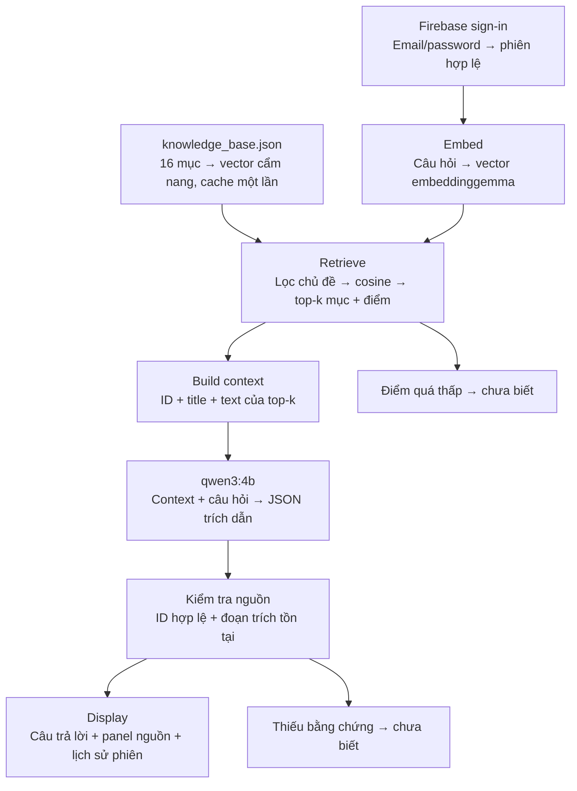

# Lumen Travel — Sài Gòn

Bài cá nhân Practice 03 — Computational Thinking.

- Sinh viên: **Võ Minh Trí**
- MSSV: **25127245**
- Thành phố: **TP. Hồ Chí Minh**
- Giao diện: Streamlit. Đăng ký, đăng nhập và đăng xuất: Firebase Email/Password.
- Embedding: **embeddinggemma**. Sinh câu trả lời: **qwen3:4b**, qua Ollama + Pinggy.
- Cẩm nang: 16 mục tự diễn đạt từ các nguồn du lịch được dẫn trong `knowledge_base.json`, đối chiếu ngày 11/11/2026.

Chỉ người đã đăng nhập được mở chat. Mỗi câu trả lời có ID nguồn như `[G01]`; mục mở rộng cho xem các đoạn tìm được và điểm cosine. Lịch sử nằm trong `st.session_state`, được xoá khi đăng xuất. Không dùng Firestore hoặc cơ sở dữ liệu hội thoại.

## Cài đặt và chạy

Python 3.12. Có thể dùng môi trường Python dùng chung đã có, hoặc cài dependencies vào môi trường bạn chọn:

```powershell
python -m pip install -r requirements.txt
Copy-Item .env.example .env
```

Điền cấu hình trong `.env`:

| Biến | Nội dung |
|---|---|
| `FIREBASE_API_KEY` | Web API key của Firebase project đã bật Email/Password |
| `OLLAMA_BASE_URL` | Link HTTPS Pinggy, không thêm `/api/chat` hoặc `/api/embed` |
| `OLLAMA_API_TOKEN` | Token riêng do notebook server tạo |
| `RAG_TOP_K` | Có thể để trống để dùng 3 |
| `RAG_MIN_SIMILARITY` | Có thể để trống để dùng 0.35; cần đánh giá theo tập câu hỏi thực tế |

```powershell
streamlit run app.py
```

Mở địa chỉ mà Streamlit thông báo, thông thường là `http://127.0.0.1:8501`.

`.env.example` chỉ có giá trị trống. `.env` bị loại khỏi Git. Không đưa tài khoản thử, mật khẩu hoặc token vào README và video.

### Firebase từ đầu

1. Tạo project trên [Firebase Console](https://console.firebase.google.com/), sử dụng gói Spark; không cần Firestore.
2. Trong **Authentication → Sign-in method**, bật **Email/Password**.
3. Trong **Project settings**, tạo một Web app và lấy **Web API Key**; đặt vào `FIREBASE_API_KEY` trong `.env`.
4. Chạy ứng dụng, chọn **Tạo tài khoản**. Firebase quản lý tài khoản; ứng dụng chỉ giữ token phiên trong bộ nhớ.

Tài liệu chính thức: [Firebase Auth REST API](https://firebase.google.com/docs/reference/rest/auth).

### Ollama + Pinggy từ đầu

[Mở notebook server bằng Google Colab](https://colab.research.google.com/github/vo-m-tri1412/lumen-travel-assistant/blob/main/server/ollama_pinggy.ipynb).

1. Chọn **Runtime → Change runtime type → T4 GPU** hoặc một GPU khả dụng.
2. Chạy các ô theo thứ tự. Notebook cài Ollama trên Colab, tải `embeddinggemma` và `qwen3:4b`, rồi mở tunnel Pinggy.
3. Chép `OLLAMA_BASE_URL` và `OLLAMA_API_TOKEN` notebook in ra vào `.env` trên máy chạy Streamlit.
4. Giữ runtime Colab hoạt động. Khi tunnel hết hạn hoặc khởi động lại, thay link/token mới và khởi động lại Streamlit.

Proxy ở `server/proxy.py` yêu cầu token và chỉ chuyển tiếp các API, model cần cho bài; không mở quyền pull/xoá model qua tunnel. Không có giá trị token cố định trong notebook.

Tài liệu: [Ollama embeddings](https://docs.ollama.com/capabilities/embeddings), [Ollama chat](https://docs.ollama.com/api/chat), [Pinggy HTTP tunnels](https://pinggy.io/docs/http_tunnels/).

## Luồng xử lý và Computational Thinking

### Abstraction

Đầu vào là một câu hỏi và chủ đề tuỳ chọn. Đầu ra là các câu trích từ cẩm nang kèm ID nguồn, hoặc thông báo chưa biết. Không truy cập web để trả lời trực tiếp và không tự điền giá, giờ mở cửa còn thiếu.

Mỗi mục giữ `id`, `title`, `text`, `source` để truy xuất và kiểm chứng. `category` dùng để lọc chủ đề; `tags` chuẩn bị cho RAG-Rec. Ảnh, bình luận và thông tin đặt chỗ không được đưa vào mô hình dữ liệu nhỏ này.

### Decomposition



### Pattern recognition

Tái sử dụng mẫu giao diện Streamlit và phiên Firebase từ Lab 3, HTTP Ollama và embedding từ Lab 4. Mẫu **filter → score → top-k** xuất hiện khi lọc mục theo chủ đề, tính cosine và lấy các mục cao điểm nhất. Trong RAG-Rec, có thể mở rộng bộ lọc theo `category`/`tags`, rồi xếp hạng địa điểm theo sở thích; không cần đổi schema cẩm nang.

### Algorithm design

```text
ANSWER(question, session, category):
    kiểm tra phiên Firebase và câu hỏi không rỗng
    lấy chỉ mục cẩm nang đã cache theo hash nội dung + máy chủ
    candidates ← các mục khớp category (hoặc tất cả)
    query_vector ← embeddinggemma(question)
    hits ← top-k theo cosine(candidates, query_vector)
    nếu không có hits hoặc điểm cao nhất dưới ngưỡng: trả "chưa biết"
    context ← id, title, text của hits
    draft ← qwen3:4b(question, context, JSON schema)
    nếu model báo không đủ dữ kiện: trả "chưa biết"
    nếu ID không thuộc hits hoặc quote không xuất hiện trong nguồn: trả "chưa biết"
    trả các quote đã kiểm tra, mỗi quote kèm [ID]
```

Lựa chọn chính: **k = 3** và câu trả lời dạng trích xuất. Ví dụ G05 mô tả Bảo tàng Mỹ thuật nhưng không có giá vé, nên câu hỏi về giá vé phải nhận “chưa biết”, kể cả G05 có điểm truy xuất cao. Điểm cosine không được coi là bằng chứng rằng thông tin được hỏi tồn tại.

## Kiểm thử

Kiểm thử logic, không cần tài khoản thật hoặc máy chủ model:

```powershell
python -m unittest discover -s tests -v
```

Kiểm thử **model thật** sau khi cấu hình server:

```powershell
python evaluate.py --update-readme
```

Script embed toàn bộ cẩm nang một lần, chạy từng câu hỏi và lưu ID/điểm/câu trả lời vào `evaluation/results.json`. Bảng bên dưới chỉ được cập nhật từ lần chạy đó; kết quả mock không thay cho kết quả model thật.

<!-- TEST_RESULTS_START -->
Chưa chạy đánh giá model thật: cần cấu hình Ollama + Pinggy. Tập `evaluation/questions.json` có 8 câu: 3 trả lời được, 1 diễn đạt lại, 2 ngoài cẩm nang và 2 tình huống khó.
<!-- TEST_RESULTS_END -->

## Cấu trúc

```text
app.py                  Giao diện, cache và luồng phiên đăng nhập
firebase_client.py      Firebase REST, làm mới token và đăng xuất
rag.py                  Embedding, cosine top-k, generation và kiểm tra nguồn
config.py               Đọc .env và kiểm tra cấu hình
knowledge_base.json     16 mục có nguồn, category và tags
evaluate.py             Đánh giá thật và cập nhật bảng kết quả
evaluation/questions.json
server/proxy.py         Proxy có xác thực cho tunnel
server/ollama_pinggy.ipynb
tests/                  Kiểm thử logic và luồng Streamlit
```

## Giới hạn và hỗ trợ AI

- Cẩm nang nhỏ, không có thời tiết trực tiếp, tình trạng chỗ trống hoặc mọi loại giá vé. Giá/giờ trong nguồn có thể thay đổi sau ngày đối chiếu.
- Trích dẫn được kiểm tra theo chuỗi gốc nên có thể từ chối một câu trả lời đúng nếu model diễn đạt lại. Kiểm tra đoạn trích không chứng minh rằng đoạn đó thực sự trả lời đủ câu hỏi; lỗi chọn bằng chứng vẫn có thể xảy ra.
- Lịch sử được lưu để xem trong phiên; việc truy xuất xử lý từng câu độc lập. Câu như “ở đó” nên viết lại với tên địa điểm.
- Ngưỡng cosine phụ thuộc dữ liệu và embedding; không phải xác suất đúng. Máy chủ Colab/Pinggy cần đang hoạt động.
- Có dùng trợ lý AI để hỗ trợ soạn mã và nội dung trình bày. Các kết quả kiểm thử phải được chạy riêng và không suy ra từ gợi ý của công cụ.

## Video demo

Chưa bổ sung video. Video tối đa 5 phút cần có đăng nhập, câu hỏi có nguồn, câu hỏi thiếu dữ liệu, đăng xuất; bốn bước Computational Thinking; một trường hợp thành công và một trường hợp thất bại có chỉ rõ bước lỗi.
